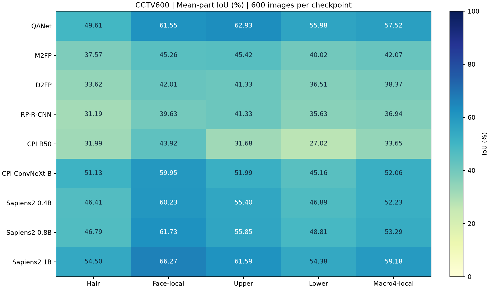

# Human Parsing บน CCTV Human Parsing 600 Dataset

**ปิดรอบครบ 9/9 โมเดล — 600 ภาพและ 763 ROI ต่อโมเดล** พร้อม dedicated timing บน Tesla T4 ครบโมเดลละ 3 รอบ รายงานนี้ใช้คำตอบของบุคคลและส่วนที่มี annotation ไม่ใช่คะแนนเต็มฉาก

[รายงานผลฉบับเต็ม](reports/CCTV600_RESULTS_TH.md) · [คะแนน CSV](metrics/SUMMARY.csv) · [รายคลาส CSV](metrics/PER_TARGET.csv) · [เวลา CSV](metrics/TIMING.csv) · [Result index/hashes](metrics/RESULT_INDEX.json) · [สถานะ](STATUS.md) · [Dataset/คู่มือ annotation](https://github.com/folklazy/CCTV-Human-Parsing-600-Dataset)

## ผลหลัก

**Sapiens2 1B ได้ Macro4-local สูงสุด 59.184%** ตามด้วย **QANet 57.517%** ต่างกัน **1.667 จุดเปอร์เซ็นต์** Sapiens2 1B สูงสุดด้าน Hair และ Face-local ส่วน QANet สูงสุดด้าน Upper/Lower เมื่อใช้ Mean-part IoU การเลือกนี้อ้างคุณภาพบน reference ชุดนี้ ไม่ใช่ deployment acceptance หรือผลนัยสำคัญทางสถิติ

| โมเดล | Hair % | Face-local % | Upper % | Lower % | mIoU3 % | Macro4-local % |
| --- | --- | --- | --- | --- | --- | --- |
| QANet | 49.606 | 61.551 | 62.933 | 55.977 | 56.172 | 57.517 |
| M2FP | 37.568 | 45.256 | 45.421 | 40.018 | 41.002 | 42.066 |
| D2FP | 33.616 | 42.013 | 41.333 | 36.514 | 37.155 | 38.369 |
| RP-R-CNN | 31.190 | 39.629 | 41.328 | 35.630 | 36.049 | 36.944 |
| CPI R50 | 31.989 | 43.922 | 31.677 | 27.018 | 30.228 | 33.652 |
| CPI ConvNeXt-B | 51.133 | 59.953 | 51.985 | 45.155 | 49.425 | 52.057 |
| Sapiens2 0.4B | 46.412 | 60.227 | 55.404 | 46.890 | 49.569 | 52.233 |
| Sapiens2 0.8B | 46.787 | 61.729 | 55.848 | 48.806 | 50.480 | 53.293 |
| Sapiens2 1B | 54.501 | 66.266 | 61.586 | 54.384 | 56.823 | 59.184 |



## อ่านคะแนนให้ตรงคำถาม

| ชื่อ | ความหมาย |
| --- | --- |
| Mean-part IoU | คิด IoU ของแต่ละ GT part ก่อนเฉลี่ย แต่ละส่วนมีน้ำหนักเท่ากัน |
| Face-local | คิด IoU ภายในกรอบ GT Face พอดี โดยใช้ Sapiens Face_Neck + facial subparts เป็น proxy |
| Macro4-local | เฉลี่ย Hair/Face-local/Upper/Lower คลาสละ 25% |
| mIoU3 part-mean | เฉลี่ย Hair/Upper/Lower เท่ากัน ไม่ใช่ C3 global เดิม |
| Pooled IoU / Precision / Recall / F1-Dice | รวมพิกเซล TP/FP/FN ก่อนหาร อ่านแยกจาก Mean-part |

GT ที่ใช้จริง: **769 คน; Hair 544 / Face 384 / Upper 745 / Lower 668 ส่วน** Missing parts ไม่เท่ากับ confirmed absent คน GT ที่จับคู่ไม่ได้ยังได้ศูนย์และอยู่ในตัวหาร Source ID0 เป็น Unassigned; full-scene person AP/Precision/F1 และ global semantic background metrics ยังไม่รองรับจาก coverage นี้

## Pipeline และการเปรียบเทียบ

ภาพ → frozen YOLO26x-Seg → RGB person crop พร้อม context 10% → native parser FP32/batch1/no extra TTA → original-grid mask → YOLO mask ownership หลังทำนาย → native-class mapping → GT bbox matching/part scoring

ทุกโมเดลใช้ input population, YOLO cache/crops, GT valid domain และ matcher ร่วมกัน คะแนนอ้าง checkpoint + application configuration การใช้ native20/native29, Face_Neck proxy และ Dress/Apparel เป็น OTHER ไม่ทำให้ taxonomy เท่ากันทั้งหมด ขอบเขต Face-local และเกณฑ์ขนาด ≥50 px เป็นกติกาเฉพาะที่ประกาศไว้

## รายละเอียดที่เปิดดูได้

- [Precision/Recall/F1 และจำนวนส่วนที่พลาด](reports/CCTV600_RESULTS_TH.md#precision-recall-f1-และความครบของแต่ละส่วน) พร้อม counts/support/union และสูตร
- [Confusion matrix](reports/CCTV600_RESULTS_TH.md#confusion-matrix-และการอ่านความผิดพลาด): binary 2×2 ครบ 36 ชุด และ cross-class 4×5 ครบเก้าโมเดล
- [เวลาแต่ละขั้นและ Peak VRAM](reports/CCTV600_RESULTS_TH.md#เวลาและทรัพยากร): แยก quality run กับ dedicated timing รวมถึงหน่วยต่อ ROI/ภาพ/ทั้งชุด
- [Model/checkpoint/config/environment bindings](reports/CCTV600_RESULTS_TH.md#รุ่นโมเดลและ-provenance) รวม implementation revisions ของ CPI และ hashes
- [หลักฐานมาตรฐานและข้อจำกัด](reports/CCTV600_RESULTS_TH.md#มาตรฐาน-แหล่งอ้างอิง-และขอบเขตคำอ้าง): paper/official implementation แต่ละแหล่งรองรับเรื่องใด และกติกาใดออกแบบเอง
- [ตรวจเทียบ CCTV90](reports/CCTV600_RESULTS_TH.md#cctv90-comparison): สูตรร่วมกัน แต่ภาพ/GT/matcher/YOLO cache/timer ไม่เหมือนกันทุกประการ

ภาพ RGB/GT/predictions จริงอยู่ใน private gallery ชุด **16 ภาพเดิม × 9 โมเดล** ไม่เลือกตามคะแนน อ่าน [วิธีเปิด gallery](reports/CCTV600_RESULTS_TH.md#ภาพเปรียบเทียบจาก-saved-predictions) ภาพสถิติใน Git ไม่มีภาพ dataset

## ตรวจรายงานและสร้างตารางซ้ำ

```bash
python3 src/publication.py --check
python3 src/publication.py --from-index metrics/RESULT_INDEX.json
```

คำสั่งแรกใช้ Python standard library ส่วนคำสั่งสร้างกราฟต้องมี numpy/matplotlib ใน environment เดิมที่รองรับ เป็นงาน CPU จาก accepted aggregates ไม่มี inference/rescore/download ข้อมูลคนละภาพไม่ขึ้น Git และ null ไม่ถูกแทนด้วย 0 รายละเอียดการรันโมเดลต้องมี private assets และ workspace adapters ตาม bindings ไม่ใช่ติดตั้งจาก requirements แล้ว reproduce ได้ทันที

[Source scorer](src/scoped_metrics.py) · [Native collector](src/reference_collection.py) · [Timer](src/worker.py) · [Publication source](src/publication.py) · [บันทึกงาน](WORK_LOG.md)

แหล่งอ้างอิงหลัก: [CIHP/PGN](https://arxiv.org/abs/1808.00157v1), [MMSegmentation IoUMetric](https://github.com/open-mmlab/mmsegmentation/blob/v1.2.2/mmseg/evaluation/metrics/iou_metric.py), [NightOwls](https://www.nightowls-dataset.org/examples/), [Datasheets for Datasets](https://arxiv.org/abs/1803.09010v8) ใช้ประกอบการออกแบบและตรวจสูตร ไม่ใช่การรับรอง protocol/annotation ของชุดนี้จากเจ้าของ paper

สถานะและไฟล์ evidence ที่ระบุ run เก่าเป็น historical snapshots ให้ยึด [result index ปัจจุบัน](metrics/RESULT_INDEX.json) และรายงานหลักสำหรับผลส่งมอบ ประวัติการขัดจังหวะเก็บไว้ ไม่มีการนำ failed attempts มาปิดบังด้วย final failed=0
