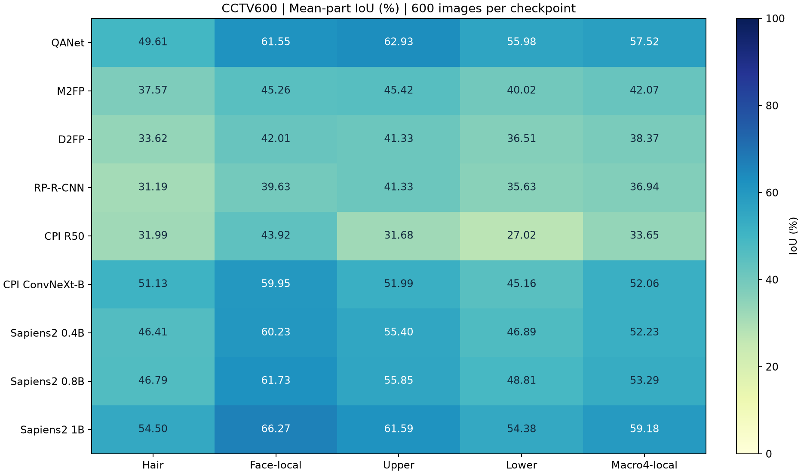
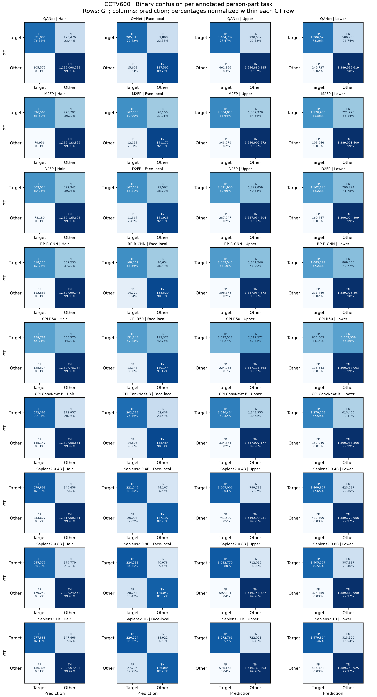
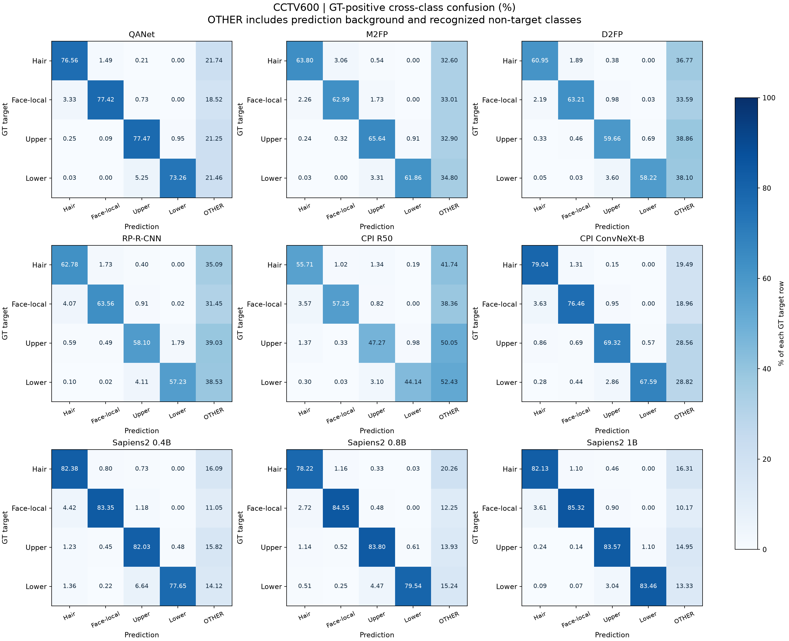

# ผล Human Parsing บน CCTV600

ปิดรอบ **2026-11-18T11:12:31+07:00 — Asia/Bangkok** คะแนนและผลทำนายครบ **9 โมเดล × 600 ภาพ** โมเดลละ **763 ROI**; dedicated timing ครบ **27/27 รอบ** บน **NVIDIA Tesla T4**

[ตาราง CSV](../metrics/SUMMARY.csv) · [สถิติรายคลาส](../metrics/PER_TARGET.csv) · [เวลาแต่ละรอบ](../metrics/TIMING.csv) · [Result index และ hashes](../metrics/RESULT_INDEX.json) · [Dataset และคู่มือ annotation](https://github.com/folklazy/CCTV-Human-Parsing-600-Dataset)

## ข้อสรุปสำหรับเลือกโมเดล

**Sapiens2 1B ได้ Macro4-local สูงสุด 59.184%** ตามด้วย **QANet 57.517%** ต่างกัน **1.667 จุดเปอร์เซ็นต์** เมื่อให้สี่คลาสมีน้ำหนักเท่ากัน ผลรายเป้าหมายอยู่ในตารางด้านล่าง ไม่มีการทดสอบนัยสำคัญทางสถิติหรือ deployment acceptance ในรอบนี้

## คะแนนรายคลาสและค่าเฉลี่ย

| โมเดล | Hair % | Face-local % | Upper % | Lower % | mIoU3 % | Macro4-local % |
| --- | --- | --- | --- | --- | --- | --- |
| QANet | 49.606 | 61.551 | 62.933 | 55.977 | 56.172 | 57.517 |
| M2FP | 37.568 | 45.256 | 45.421 | 40.018 | 41.002 | 42.066 |
| D2FP | 33.616 | 42.013 | 41.333 | 36.514 | 37.155 | 38.369 |
| RP-R-CNN | 31.190 | 39.629 | 41.328 | 35.630 | 36.049 | 36.944 |
| CPI R50 | 31.989 | 43.922 | 31.677 | 27.018 | 30.228 | 33.652 |
| CPI ConvNeXt-B | 51.133 | 59.953 | 51.985 | 45.155 | 49.425 | 52.057 |
| Sapiens2 0.4B | 46.412 | 60.227 | 55.404 | 46.890 | 49.569 | 52.233 |
| Sapiens2 0.8B | 46.787 | 61.729 | 55.848 | 48.806 | 50.480 | 53.293 |
| Sapiens2 1B | 54.501 | 66.266 | 61.586 | 54.384 | 56.823 | 59.184 |



ตารางเรียงตาม frozen roster ไม่ใช่เรียงอันดับ แต่ละส่วน GT มีน้ำหนักเท่ากันภายในคลาส Face ใช้ **Face-local**; Upper/Lower เป็นกลุ่ม **non-Dress** ตาม mapping ไม่ใช่ taxonomy ที่เท่ากันทุก checkpoint

| เป้าหมาย | สูงสุด | Mean-part IoU % | อันดับถัดไป | ส่วนต่าง (จุดเปอร์เซ็นต์) |
| --- | --- | --- | --- | --- |
| Hair | Sapiens2 1B | 54.501 | CPI ConvNeXt-B | 3.368 |
| Face_local | Sapiens2 1B | 66.266 | Sapiens2 0.8B | 4.537 |
| Upper | QANet | 62.933 | Sapiens2 1B | 1.347 |
| Lower | QANet | 55.977 | Sapiens2 1B | 1.594 |

เมื่อรวมพิกเซลก่อนหาร (**pooled IoU**) Sapiens2 1B สูงสุดทั้งสี่คลาส ผลนี้ตอบคนละคำถามกับ Mean-part: ส่วนที่มี union ใหญ่มีน้ำหนักมากกว่า ห้ามสลับสองตารางแล้วอธิบายว่าเป็น metric เดียวกัน

## วิธีทดสอบและพื้นที่ที่ประเมิน

ใช้ภาพ 600 ภาพและคำตอบของบุคคลที่เลือก annotate มี GT bbox ผ่านเกณฑ์ด้านยาว ≥50 px จำนวน 769 คน ทุกโมเดลใช้ frozen YOLO26x-Seg cache ชุดเดียวกัน เลือก confidence ≥0.25 แล้วส่ง RGB crop พร้อม context 10% เข้า parser โดยไม่ระบายพื้นหลัง หลังทำนายจึงใช้ YOLO instance mask จัด ownership โมเดลที่คืนหลาย instances เลือกด้วย predicted-box IoU ≥0.50 กับกรอบ YOLO โดยไม่ใช้ GT

คง native preprocessing, resolution, FP32, batch1, eval, no AMP/TF32/extra TTA ของแต่ละ checkpoint ทำนาย native20/native29 ก่อนแปลงคลาส บันทึก masks บนพิกัดภาพต้นฉบับ ทุกระบบใช้ GT/domain/matcher ชุดเดียวกันภายในงานนี้ ไม่ได้ทำให้ input conditioning ภายใน native architectures เหมือนกันทั้งหมด

จับคู่ผลกับ GT ด้วย bbox IoU ≥0.50 เรียง prediction ตาม confidence และ geometry เลือก GT ที่ IoU สูงสุดโดยไม่ซ้ำ กรณี geometry เสมอใช้ลำดับที่ประกาศไว้ ไม่มีการใช้ semantic score เลือกคู่ รายงาน bbox IoU ≥0.75 เป็น person diagnostic เพิ่ม คน GT ที่จับคู่ไม่เจอใช้ prediction ว่างและส่วน GT ยังคงได้ IoU ศูนย์ในตัวหาร

- **Hair/Upper/Lower:** เทียบ prediction ของคนที่จับคู่กับส่วน GT ของคนนั้นบน shared valid grid ทั้งภาพ ทายเกิน reference part เป็น FP ทายขาดเป็น FN ตามขอบอ้างอิงที่ผู้จัดทำยอมรับ
- **Face-local:** ใช้กรอบครอบ raw GT Face พอดี ไม่มี margin ตัดกับ shared valid grid พื้นที่นอกกรอบไม่เข้าสู่คะแนน ใช้ GT เฉพาะ scoring หลัง inference จึงไม่ใช่ face detection โดยไม่มีกรอบ GT
- **Shared VOID:** explicit ignore, คนต่ำกว่า 50 px, class/owner conflicts และ degenerate geometry ใช้ร่วมกันทุกโมเดล Source ID0 ยังคง Unassigned ไม่ใช่คำยืนยัน background ทั้งฉาก ไม่มี historical shape-index exclusions ใน fresh run นี้
- **ไม่มี part annotation:** ไม่สร้าง task ของ owner/class นั้น ไม่อนุมานว่าเป็น absent ส่วนที่ไม่มี valid GT support ยกเว้นตาม GT bindings

| Target | GT parts ที่ประเมิน | GT support (พิกเซล) |
| --- | --- | --- |
| Hair | 544 | 825,356 |
| Face_local | 384 | 265,216 |
| Upper | 745 | 4,394,789 |
| Lower | 668 | 1,892,964 |

Shared VOID รวม 725,799 พิกเซล หนึ่ง Hair part ถูกยกเว้นทั้งหมดหลัง conflict VOID ส่วน overlaps ที่ผู้จัดทำยืนยันยังเก็บใน source ไม่แก้ polygon เพื่อเพิ่มคะแนน

### ค่าการทดลองและข้อจำกัดทรัพยากร

| รายการ | ค่าที่บันทึกไว้ |
| --- | --- |
| GPU | NVIDIA Tesla T4; precision FP32, batch1, eval, no AMP/TF32/extra TTA |
| Detector cache | YOLO26x-Seg, imgsz 640, rect=False, retina_masks=True, NMS IoU setting 0.70, max_det 1000 |
| Detector confidence | สร้าง cache ด้วย floor 0.001 สำหรับ detector study แล้วใช้ ≥0.25 เป็น parser workload เดียวกันทุกโมเดล |
| Parser input | RGB crop +10% context แต่ละด้าน ขยายให้ครอบ detector mask; native resize/normalization ตาม checkpoint config ที่ผูก hashes |
| Warmup | CIHP TRAIN0000930 หนึ่งภาพต่อ quality process; 10 calls ต่อ dedicated process ไม่เข้าสู่คะแนน CCTV และไม่ใช่ training |
| Quality resource policy | SHARED_GPU_QUALITY_ONLY ตาม guards ไม่ปิด process งานอื่น |
| Guards | free disk ≥50 GiB, retained output ตาม max run/model 80 GiB, max model execution 24 ชั่วโมง, physical free VRAM ก่อน forward ≥1024 MiB และ model-specific admission ตาม config |
| Failure handling | stop affected work, atomic packets, immutable attempt history, zero automatic model/OOM retries; continuation ต้องตรวจ bindings ก่อน reuse |

Image/GT eligibility, valid domains และแหล่ง predictions ยึด current bindings ไม่ใช้ค่าตั้งต้นของ framework ตีความแทน resource/timing records Detector cache ไม่ได้ถูกสร้างใหม่ระหว่างการทดสอบ parser นี้

### Mapping และความหมายของสี่คลาส

| Target | CIHP native IDs | Sapiens native IDs | ขอบเขตคำอ้าง |
| --- | --- | --- | --- |
| Hair | 2 | 4 | ผมตาม reference ที่ annotate |
| Face-local | 13 | 3 และ 24–28 | Sapiens Face_Neck + facial subparts เป็น proxy ภายในกรอบ GT Face ไม่รับรอง strict face-only/neck quality |
| Upper | 5 + 7 | 23 | UpperClothes + Coat เทียบ Upper_Clothing; non-Dress |
| Lower | 9 + 12 | 13 | Pants + Skirt เทียบ Lower_Clothing; non-Dress |
| OTHER | คลาสอื่น รวม Dress 6 | คลาสอื่น รวม Apparel 1 | ไม่มีการแบ่ง dress ด้วยเส้นตัดหรือปรับ mapping ตามคะแนน |

Source GT Hair=1/Face=2/Upper=3/Lower=4 แปลงเป็น shared target Face=1/Hair=2/Upper=3/Lower=4 ก่อนนับ การรวมคลาสใช้ union ของ masks จริง ไม่เฉลี่ย IoU ของ native subclasses Native prediction Background0 คงเป็น0 ส่วน recognized non-target classes map เป็น5=OTHER; คอลัมน์ OTHER ใน cross-confusion รวมทั้ง prediction0และ5 ภายหลัง Source GT0 ยังคงเป็น Unassigned ตาราง native mapping ครบ 0–19/0–28 อยู่ใน result index; unknown prediction IDs หรือ prediction255 เป็น contract failure

## ตัวชี้วัด: สูตร ตัวหาร และสิ่งที่บอก

TP คือพิกเซลทายถูก FP คือพิกเซลทายเกิน และ FN คือ GT ที่ทายขาด ภายใน domain ของ GT person-part นั้น

| ตัวชี้วัด | คำนวณอย่างไร | ใช้อธิบายอะไร |
| --- | --- | --- |
| IoU ของหนึ่งส่วน | TP ÷ (TP+FP+FN) | ความทับกันพร้อมโทษส่วนเกินและส่วนขาด |
| Mean-part IoU | บวก IoU ของแต่ละ GT part แล้วหารจำนวน eligible parts ในคลาส | ให้แต่ละส่วนมีน้ำหนักเท่ากัน รวมคนที่พลาดด้วยศูนย์ |
| Pooled IoU | รวม TP/FP/FN ในคลาสก่อนหาร | ความทับกันจากจำนวนพิกเซลรวม ต่างจากการเฉลี่ยรายส่วน |
| Precision | TP ÷ (TP+FP) จาก counts รวม | พิกเซลที่ทายมา ถูกต้องกี่ส่วน |
| Recall | TP ÷ (TP+FN) จาก counts รวม | เก็บพิกเซล GT ได้ครบแค่ไหน |
| F1/Dice | 2TP ÷ (2TP+FP+FN) | สมดุลการทายเกินและทายขาด; F1 เท่ากับ Dice เมื่อใช้ counts/domain เดียวกัน |
| Macro4-local | เฉลี่ย Mean-part IoU ทั้งสี่คลาส คลาสละ 25% | เกณฑ์เลือกหลักของงานนี้ ไม่ใช่ global semantic mIoU |
| mIoU3 part-mean | เฉลี่ย Hair/Upper/Lower คลาสละหนึ่งในสาม | ผลสามคลาสที่ไม่ใช้ Face-local ไม่ใช่ C3 global เดิม |
| ส่วนที่พลาดทั้งหมด | จำนวน GT parts ที่ TP=0 ÷ eligible parts | รวมทั้งคนที่จับคู่ไม่ได้และคนที่จับคู่ได้แต่ไม่มีพิกเซลถูก |

ตัวอย่างสมมติ: ส่วนเล็กมี IoU 0% ส่วนใหญ่มี IoU 100% จะได้ Mean-part IoU 50% ส่วน pooled ต้องใช้จำนวนพิกเซลจริงจึงยังคำนวณจากสองเปอร์เซ็นต์นี้ไม่ได้ ตัวหารศูนย์แสดง null/— ไม่แทนด้วย 0 คะแนนหลักของผลไม่ครบเป็น null ตาม STRICT_COMPLETE

ตัวอย่างผลจริงของ QANet: Hair มี GT 544 ส่วน ในจำนวนนี้ 106 ส่วนไม่มีพิกเซลทายถูกเลย โดย 62 ส่วนอยู่กับคนที่จับคู่ไม่ได้ และอีก 44 ส่วนจับคู่คนได้แต่ TP=0 กลุ่มหลังอาจมีผลว่าง ผิดคลาส ผิดตำแหน่งหรือ ownership ผิด ต้องดู masks เพื่อแยกสาเหตุ ไม่ใช่เพียงคำว่าขอบ mask ไม่เนียน

## Precision, Recall, F1 และความครบของแต่ละส่วน

| โมเดล | Target | Mean-part IoU % | Pooled IoU % | Precision % | Recall % | F1/Dice % | GT parts | TP=0 parts |
| --- | --- | --- | --- | --- | --- | --- | --- | --- |
| QANet | Hair | 49.606 | 67.877 | 85.684 | 76.559 | 80.865 | 544 | 106 |
| QANet | Face_local | 61.551 | 73.091 | 92.899 | 77.415 | 84.454 | 384 | 48 |
| QANet | Upper | 62.933 | 70.115 | 88.071 | 77.472 | 82.432 | 745 | 146 |
| QANet | Lower | 55.977 | 64.718 | 84.739 | 73.255 | 78.580 | 668 | 135 |
| M2FP | Hair | 37.568 | 58.164 | 86.817 | 63.798 | 73.549 | 544 | 216 |
| M2FP | Face_local | 45.256 | 60.240 | 93.237 | 62.992 | 75.187 | 384 | 129 |
| M2FP | Upper | 45.421 | 60.877 | 89.347 | 65.642 | 75.681 | 745 | 307 |
| M2FP | Lower | 40.018 | 56.111 | 85.791 | 61.860 | 71.886 | 668 | 288 |
| D2FP | Hair | 33.616 | 55.672 | 86.548 | 60.945 | 71.525 | 544 | 250 |
| D2FP | Face_local | 42.013 | 60.614 | 93.650 | 63.212 | 75.478 | 384 | 154 |
| D2FP | Upper | 41.333 | 56.002 | 90.132 | 59.660 | 71.797 | 745 | 340 |
| D2FP | Lower | 36.514 | 53.675 | 87.293 | 58.225 | 69.855 | 668 | 321 |
| RP-R-CNN | Hair | 31.190 | 55.224 | 82.113 | 62.776 | 71.154 | 544 | 230 |
| RP-R-CNN | Face_local | 39.629 | 60.204 | 91.944 | 63.556 | 75.159 | 384 | 146 |
| RP-R-CNN | Upper | 41.328 | 54.314 | 89.278 | 58.104 | 70.394 | 745 | 236 |
| RP-R-CNN | Lower | 35.630 | 51.482 | 83.670 | 57.233 | 67.971 | 668 | 251 |
| CPI R50 | Hair | 31.989 | 48.351 | 78.547 | 55.707 | 65.184 | 544 | 201 |
| CPI R50 | Face_local | 43.922 | 54.549 | 92.032 | 57.253 | 70.591 | 384 | 111 |
| CPI R50 | Upper | 31.677 | 44.970 | 90.229 | 47.272 | 62.041 | 745 | 274 |
| CPI R50 | Lower | 27.018 | 41.545 | 87.594 | 44.143 | 58.703 | 668 | 306 |
| CPI ConvNeXt-B | Hair | 51.133 | 67.223 | 81.801 | 79.045 | 80.399 | 544 | 107 |
| CPI ConvNeXt-B | Face_local | 59.953 | 72.415 | 93.195 | 76.458 | 84.001 | 384 | 60 |
| CPI ConvNeXt-B | Upper | 51.985 | 64.418 | 90.110 | 69.319 | 78.359 | 745 | 194 |
| CPI ConvNeXt-B | Lower | 45.155 | 62.568 | 89.379 | 67.593 | 76.974 | 668 | 223 |
| Sapiens2 0.4B | Hair | 46.412 | 63.013 | 72.831 | 82.376 | 77.310 | 544 | 98 |
| Sapiens2 0.4B | Face_local | 60.227 | 75.881 | 89.442 | 83.347 | 86.287 | 384 | 63 |
| Sapiens2 0.4B | Upper | 55.404 | 70.185 | 82.938 | 82.029 | 82.481 | 745 | 141 |
| Sapiens2 0.4B | Lower | 46.890 | 63.759 | 78.091 | 77.649 | 77.870 | 668 | 185 |
| Sapiens2 0.8B | Hair | 46.787 | 64.262 | 78.269 | 78.218 | 78.244 | 544 | 119 |
| Sapiens2 0.8B | Face_local | 61.729 | 76.411 | 88.812 | 84.549 | 86.628 | 384 | 57 |
| Sapiens2 0.8B | Upper | 55.848 | 73.838 | 86.135 | 83.799 | 84.951 | 745 | 153 |
| Sapiens2 0.8B | Lower | 48.806 | 66.403 | 80.087 | 79.535 | 79.810 | 668 | 189 |
| Sapiens2 1B | Hair | 54.501 | 70.491 | 83.259 | 82.133 | 82.692 | 544 | 89 |
| Sapiens2 1B | Face_local | 66.266 | 77.386 | 89.268 | 85.324 | 87.252 | 384 | 53 |
| Sapiens2 1B | Upper | 61.586 | 73.855 | 86.399 | 83.571 | 84.962 | 745 | 135 |
| Sapiens2 1B | Lower | 54.384 | 68.411 | 79.140 | 83.460 | 81.243 | 668 | 135 |

## Confusion matrix และการอ่านความผิดพลาด



แต่ละช่องย่อยเป็น binary matrix **[[TP,FN],[FP,TN]]** แถวเป็น GT คอลัมน์เป็น prediction สีและเปอร์เซ็นต์หารภายในแถว GT: ช่อง TP% ของแถว Target คือ Recall; FN% คือสัดส่วน GT ที่พลาด ไม่ใช่ Precision ของคอลัมน์ จำนวนพิกเซลในภาพเดียวกันอาจถูกนับในหลาย person-part tasks ค่า TN ใหญ่จึงไม่ใช้ accuracy มาสรุปว่า parser แม่นมาก

ตาราง cross-class ด้านล่างใช้เฉพาะ GT positive pixels: อ่านว่า Hair ถูกทายเป็น Face/Upper/Lower/OTHER เท่าไร ไม่ครอบคลุม FP ที่ทายบนพื้นที่นอก positive GT ต้องอ่านคู่กับ binary matrix และ Precision การไม่มีแถว GT OTHER ไม่ได้แปลว่าไม่มีการทายเกิน



ภาพ 4×5 นี้เป็นการแจกแจงผลทำนายแบบมีเงื่อนไขบนสี่ GT targets ที่มีคำตอบ ไม่ใช่ full-scene multiclass confusion พร้อม GT background แถวละ 100% ใช้มาตราสี 0–100 เหมือนกันทั้งเก้าโมเดล ช่องทแยงคือ pooled pixel Recall ของ target ไม่ใช่ Mean-part IoU ส่วนช่องนอกทแยงแยกการทายเป็น target อื่นกับ OTHER ตาราง counts เดิมอยู่ด้านล่างเพื่อย้อนตรวจเปอร์เซ็นต์

<details>
<summary>QANet — counts และ cross-class confusion</summary>

| GT / Prediction | Hair | Face-local | Upper | Lower | OTHER |
| --- | --- | --- | --- | --- | --- |
| Hair | 631886 | 12311 | 1754 | 7 | 179398 |
| Face_local | 8819 | 205318 | 1949 | 0 | 49130 |
| Upper | 10932 | 3851 | 3404732 | 41592 | 933682 |
| Lower | 597 | 0 | 99405 | 1386698 | 406264 |

| Target | TP | FP | FN | TN | GT support | Union | จับคู่คนไม่ได้ | TP=0 % |
| --- | --- | --- | --- | --- | --- | --- | --- | --- |
| Hair | 631,886 | 105,575 | 193,470 | 1,132,098,233 | 825,356 | 930,931 | 62 | 19.485 |
| Face_local | 205,318 | 15,693 | 59,898 | 137,597 | 265,216 | 280,909 | 34 | 12.500 |
| Upper | 3,404,732 | 461,166 | 990,057 | 1,546,880,385 | 4,394,789 | 4,855,955 | 131 | 19.597 |
| Lower | 1,386,698 | 249,727 | 506,266 | 1,389,935,619 | 1,892,964 | 2,142,691 | 111 | 20.210 |

</details>

<details>
<summary>M2FP — counts และ cross-class confusion</summary>

| GT / Prediction | Hair | Face-local | Upper | Lower | OTHER |
| --- | --- | --- | --- | --- | --- |
| Hair | 526564 | 25255 | 4453 | 0 | 269084 |
| Face_local | 6005 | 167066 | 4587 | 0 | 87558 |
| Upper | 10328 | 13987 | 2884813 | 39941 | 1445720 |
| Lower | 607 | 79 | 62583 | 1170986 | 658709 |

| Target | TP | FP | FN | TN | GT support | Union | จับคู่คนไม่ได้ | TP=0 % |
| --- | --- | --- | --- | --- | --- | --- | --- | --- |
| Hair | 526,564 | 79,956 | 298,792 | 1,132,123,852 | 825,356 | 905,312 | 62 | 39.706 |
| Face_local | 167,066 | 12,118 | 98,150 | 141,172 | 265,216 | 277,334 | 34 | 33.594 |
| Upper | 2,884,813 | 343,979 | 1,509,976 | 1,546,997,572 | 4,394,789 | 4,738,768 | 131 | 41.208 |
| Lower | 1,170,986 | 193,946 | 721,978 | 1,389,991,400 | 1,892,964 | 2,086,910 | 111 | 43.114 |

</details>

<details>
<summary>D2FP — counts และ cross-class confusion</summary>

| GT / Prediction | Hair | Face-local | Upper | Lower | OTHER |
| --- | --- | --- | --- | --- | --- |
| Hair | 503014 | 15632 | 3170 | 17 | 303523 |
| Face_local | 5799 | 167649 | 2596 | 73 | 89099 |
| Upper | 14416 | 20020 | 2621930 | 30437 | 1707986 |
| Lower | 1026 | 577 | 68065 | 1102170 | 721126 |

| Target | TP | FP | FN | TN | GT support | Union | จับคู่คนไม่ได้ | TP=0 % |
| --- | --- | --- | --- | --- | --- | --- | --- | --- |
| Hair | 503,014 | 78,180 | 322,342 | 1,132,125,628 | 825,356 | 903,536 | 62 | 45.956 |
| Face_local | 167,649 | 11,367 | 97,567 | 141,923 | 265,216 | 276,583 | 34 | 40.104 |
| Upper | 2,621,930 | 287,047 | 1,772,859 | 1,547,054,504 | 4,394,789 | 4,681,836 | 131 | 45.638 |
| Lower | 1,102,170 | 160,447 | 790,794 | 1,390,024,899 | 1,892,964 | 2,053,411 | 111 | 48.054 |

</details>

<details>
<summary>RP-R-CNN — counts และ cross-class confusion</summary>

| GT / Prediction | Hair | Face-local | Upper | Lower | OTHER |
| --- | --- | --- | --- | --- | --- |
| Hair | 518123 | 14293 | 3332 | 20 | 289588 |
| Face_local | 10791 | 168562 | 2405 | 47 | 83411 |
| Upper | 25836 | 21584 | 2553543 | 78640 | 1715186 |
| Lower | 1878 | 364 | 77890 | 1083399 | 729433 |

| Target | TP | FP | FN | TN | GT support | Union | จับคู่คนไม่ได้ | TP=0 % |
| --- | --- | --- | --- | --- | --- | --- | --- | --- |
| Hair | 518,123 | 112,865 | 307,233 | 1,132,090,943 | 825,356 | 938,221 | 62 | 42.279 |
| Face_local | 168,562 | 14,770 | 96,654 | 138,520 | 265,216 | 279,986 | 34 | 38.021 |
| Upper | 2,553,543 | 306,678 | 1,841,246 | 1,547,034,873 | 4,394,789 | 4,701,467 | 131 | 31.678 |
| Lower | 1,083,399 | 211,449 | 809,565 | 1,389,973,897 | 1,892,964 | 2,104,413 | 111 | 37.575 |

</details>

<details>
<summary>CPI R50 — counts และ cross-class confusion</summary>

| GT / Prediction | Hair | Face-local | Upper | Lower | OTHER |
| --- | --- | --- | --- | --- | --- |
| Hair | 459781 | 8434 | 11020 | 1594 | 344527 |
| Face_local | 9455 | 151844 | 2169 | 0 | 101748 |
| Upper | 60134 | 14344 | 2077517 | 43259 | 2199535 |
| Lower | 5764 | 499 | 58615 | 835605 | 992481 |

| Target | TP | FP | FN | TN | GT support | Union | จับคู่คนไม่ได้ | TP=0 % |
| --- | --- | --- | --- | --- | --- | --- | --- | --- |
| Hair | 459,781 | 125,574 | 365,575 | 1,132,078,234 | 825,356 | 950,930 | 62 | 36.949 |
| Face_local | 151,844 | 13,146 | 113,372 | 140,144 | 265,216 | 278,362 | 34 | 28.906 |
| Upper | 2,077,517 | 224,983 | 2,317,272 | 1,547,116,568 | 4,394,789 | 4,619,772 | 131 | 36.779 |
| Lower | 835,605 | 118,343 | 1,057,359 | 1,390,067,003 | 1,892,964 | 2,011,307 | 111 | 45.808 |

</details>

<details>
<summary>CPI ConvNeXt-B — counts และ cross-class confusion</summary>

| GT / Prediction | Hair | Face-local | Upper | Lower | OTHER |
| --- | --- | --- | --- | --- | --- |
| Hair | 652399 | 10840 | 1250 | 0 | 160867 |
| Face_local | 9627 | 202778 | 2517 | 0 | 50294 |
| Upper | 37830 | 30248 | 3046434 | 24995 | 1255282 |
| Lower | 5383 | 8373 | 54056 | 1279508 | 545644 |

| Target | TP | FP | FN | TN | GT support | Union | จับคู่คนไม่ได้ | TP=0 % |
| --- | --- | --- | --- | --- | --- | --- | --- | --- |
| Hair | 652,399 | 145,147 | 172,957 | 1,132,058,661 | 825,356 | 970,503 | 62 | 19.669 |
| Face_local | 202,778 | 14,806 | 62,438 | 138,484 | 265,216 | 280,022 | 34 | 15.625 |
| Upper | 3,046,434 | 334,374 | 1,348,355 | 1,547,007,177 | 4,394,789 | 4,729,163 | 131 | 26.040 |
| Lower | 1,279,508 | 152,040 | 613,456 | 1,390,033,306 | 1,892,964 | 2,045,004 | 111 | 33.383 |

</details>

<details>
<summary>Sapiens2 0.4B — counts และ cross-class confusion</summary>

| GT / Prediction | Hair | Face-local | Upper | Lower | OTHER |
| --- | --- | --- | --- | --- | --- |
| Hair | 679898 | 6637 | 6006 | 0 | 132815 |
| Face_local | 11733 | 221049 | 3120 | 0 | 29314 |
| Upper | 53854 | 19718 | 3605006 | 21030 | 695181 |
| Lower | 25780 | 4250 | 125765 | 1469877 | 267292 |

| Target | TP | FP | FN | TN | GT support | Union | จับคู่คนไม่ได้ | TP=0 % |
| --- | --- | --- | --- | --- | --- | --- | --- | --- |
| Hair | 679,898 | 253,627 | 145,458 | 1,131,950,181 | 825,356 | 1,078,983 | 62 | 18.015 |
| Face_local | 221,049 | 26,093 | 44,167 | 127,197 | 265,216 | 291,309 | 34 | 16.406 |
| Upper | 3,605,006 | 741,620 | 789,783 | 1,546,599,931 | 4,394,789 | 5,136,409 | 131 | 18.926 |
| Lower | 1,469,877 | 412,390 | 423,087 | 1,389,772,956 | 1,892,964 | 2,305,354 | 111 | 27.695 |

</details>

<details>
<summary>Sapiens2 0.8B — counts และ cross-class confusion</summary>

| GT / Prediction | Hair | Face-local | Upper | Lower | OTHER |
| --- | --- | --- | --- | --- | --- |
| Hair | 645577 | 9597 | 2705 | 231 | 167246 |
| Face_local | 7217 | 224238 | 1263 | 0 | 32498 |
| Upper | 49921 | 22842 | 3682770 | 26876 | 612380 |
| Lower | 9613 | 4695 | 84610 | 1505577 | 288469 |

| Target | TP | FP | FN | TN | GT support | Union | จับคู่คนไม่ได้ | TP=0 % |
| --- | --- | --- | --- | --- | --- | --- | --- | --- |
| Hair | 645,577 | 179,240 | 179,779 | 1,132,024,568 | 825,356 | 1,004,596 | 62 | 21.875 |
| Face_local | 224,238 | 28,248 | 40,978 | 125,042 | 265,216 | 293,464 | 34 | 14.844 |
| Upper | 3,682,770 | 592,824 | 712,019 | 1,546,748,727 | 4,394,789 | 4,987,613 | 131 | 20.537 |
| Lower | 1,505,577 | 374,356 | 387,387 | 1,389,810,990 | 1,892,964 | 2,267,320 | 111 | 28.293 |

</details>

<details>
<summary>Sapiens2 1B — counts และ cross-class confusion</summary>

| GT / Prediction | Hair | Face-local | Upper | Lower | OTHER |
| --- | --- | --- | --- | --- | --- |
| Hair | 677888 | 9097 | 3773 | 0 | 134598 |
| Face_local | 9564 | 226294 | 2397 | 1 | 26960 |
| Upper | 10528 | 6337 | 3672766 | 48216 | 656942 |
| Lower | 1763 | 1377 | 57633 | 1579864 | 252327 |

| Target | TP | FP | FN | TN | GT support | Union | จับคู่คนไม่ได้ | TP=0 % |
| --- | --- | --- | --- | --- | --- | --- | --- | --- |
| Hair | 677,888 | 136,304 | 147,468 | 1,132,067,504 | 825,356 | 961,660 | 62 | 16.360 |
| Face_local | 226,294 | 27,205 | 38,922 | 126,085 | 265,216 | 292,421 | 34 | 13.802 |
| Upper | 3,672,766 | 578,158 | 722,023 | 1,546,763,393 | 4,394,789 | 4,972,947 | 131 | 18.121 |
| Lower | 1,579,864 | 416,421 | 313,100 | 1,389,768,925 | 1,892,964 | 2,309,385 | 111 | 20.210 |

</details>

## Insight จาก confusion และตัวชี้วัดร่วมกัน

### ความผิดพลาดส่วนใหญ่ลง OTHER แต่ยังระบุสาเหตุจากคลาสอย่างเดียวไม่ได้

ใน 36 แถว target-model กลุ่ม OTHER มีจำนวนมากกว่าการทายเป็นอีกสาม target รวมกันทุกแถว คิดเป็น 63.18–96.34% ของ FN ในแต่ละแถว นี่เป็นสัดส่วนของพิกเซล GT ที่พลาด ไม่ใช่สัดส่วนของทุกพิกเซลในภาพ

OTHER รวมทั้ง native background และคลาสนอกสี่เป้าหมาย อีกทั้ง prediction ว่างของคนที่จับคู่ไม่ได้ก็ลง OTHER ทั้งส่วนได้ จึงยังสรุปไม่ได้ว่า parser ทายเป็นฉากหลังเองทั้งหมด อาจเกี่ยวกับ YOLO coverage, mask ownership clipping, native instance association หรือ semantic prediction ต้องตรวจ saved masks รายกรณีเพื่อแยกสาเหตุ

### QANet กับ Sapiens2 1B มี trade-off ระหว่างทายเกินกับเก็บ GT

| Target | QANet Precision % | QANet Recall % | Sapiens2 1B Precision % | Sapiens2 1B Recall % |
| --- | --- | --- | --- | --- |
| Hair | 85.684 | 76.559 | 83.259 | 82.133 |
| Face_local | 92.899 | 77.415 | 89.268 | 85.324 |
| Upper | 88.071 | 77.472 | 86.399 | 83.571 |
| Lower | 84.739 | 73.255 | 79.140 | 83.460 |

QANet มี Precision สูงกว่า ส่วน Sapiens2 1B มี Recall สูงกว่าในทั้งสี่คลาสของการเปรียบเทียบคู่นี้ Sapiens2 1B จึงเก็บ GT pixels ได้มากกว่าโดยมีสัดส่วนทายเกินสูงกว่า QANet ไม่ใช่ข้อพิสูจน์ว่าความต่างเกิดจาก architecture หรือ threshold เพียงอย่างเดียว ทั้งคู่ใช้ thresholds ที่ตรึงไว้

Sapiens2 1B มี pooled F1/Dice และ pooled IoU สูงกว่า QANet ทั้งสี่คลาส แต่ QANet ได้ Mean-part IoU ของ Upper/Lower สูงกว่า การเฉลี่ยรายส่วนกับการรวมพิกเซลให้ความสำคัญต่อขนาดส่วนต่างกัน จึงเป็นผลที่อยู่ร่วมกันได้ และยังไม่ยืนยันว่าโมเดลใดชนะทุกคนหรือทุกขนาด

### ค่าเฉลี่ยสูงกว่าไม่ได้แปลว่าไม่มีส่วนที่พลาดทั้งชิ้น

| Target | GT parts | จับคู่คนไม่ได้ (ทั้งคู่) | QANet TP=0 หลังจับคู่คนได้ | Sapiens2 1B TP=0 หลังจับคู่คนได้ |
| --- | --- | --- | --- | --- |
| Hair | 544 | 62 | 44 | 27 |
| Face_local | 384 | 34 | 14 | 19 |
| Upper | 745 | 131 | 15 | 4 |
| Lower | 668 | 111 | 24 | 24 |

ตัวอย่าง Face-local: Sapiens2 1B มีค่าเฉลี่ย IoU สูงกว่า แต่มี Face parts ที่ TP=0 รวม 53 ส่วน เทียบ QANet 48 ส่วน (หลังหักคนที่จับคู่ไม่ได้ เหลือ 19 กับ 14 ส่วน) จึงควรอ่านค่าเฉลี่ยควบคู่จำนวนส่วนที่พลาด ไม่ตีความว่าคะแนนสูงกว่าหมายถึงพบใบหน้าของทุกคนได้ดีกว่า ยังไม่ได้ตรวจว่ากลุ่มที่พลาดเป็นภาพเล็ก/เบลอ/แสงแบบใด

### การจับคู่คนเป็นต้นทุนร่วมของทั้งเก้าโมเดล

ที่ bbox IoU 0.50 พบคู่ 624/769 คน และพลาด 145 คน GT parts ของคนที่พลาดยังอยู่ในตัวหารด้วยศูนย์ ดังนั้น confusion นี้เป็นผลของ application pipeline ร่วมกับ parser ไม่ใช่คุณภาพ parser ภายใต้ perfect person crops ทั้งหมด ตัวเลขนี้อ้างเฉพาะคนที่ annotate; unmatched predictions ยังจัดเป็น FP ทั้งฉากไม่ได้

### ความพร้อมของข้อมูลและสิ่งที่ยังไม่รองรับ

| ประเด็น | สถานะหลักฐาน |
| --- | --- |
| Counts/สูตร/ตัวหาร/labels | ตรวจเลขจำนวนเต็มและ ratios กับ canonical statistics แล้ว; binary diagonal ตรงกับ cross-class diagonal |
| ความครบของผล | Exact 600 ภาพ/763 ROI ครบเก้าโมเดล ใช้ scoring domain เดียวกันภายในงานนี้ |
| คุณภาพ annotation | ผู้จัดทำตรวจรับและมี QA/owner/conflict checks แต่ไม่มี inter-annotator agreement หรือ independent expert gold |
| Coverage ทั้งฉาก | ยังมีคนหรือส่วนที่ไม่ annotate; ไม่รับรอง global-scene negatives และ full-scene semantic mIoU |
| Face และเสื้อผ้า | Face-local เป็น proxy ในกรอบ GT; เสื้อผ้าเป็น non-Dress mapping และยังมี taxonomy limitations |
| ข้อสรุปทั่วไป | ไม่มี independent held-out certification/uncertainty study จึงไม่อ้าง statistical significance หรือ superiority บน CCTV ทุกสภาพ |

ชุดผลพร้อมใช้รายงานการเปรียบเทียบแบบ annotated-person-part ตาม protocol นี้ ส่วนคุณภาพข้อมูลสำหรับ benchmark เต็มฉากยังรับรองไม่ได้จากการตรวจ arithmetic หรือ confusion matrix อย่างเดียว ข้อมูลสถิติที่ครบไม่ได้แทนความครบของ annotation

## การพบคนและความครบถ้วนของผล

ทุก parser ใช้ frozen YOLO extents/boxes ชุดเดียวกัน ตัวเลขการจับคู่จึงเท่ากัน ไม่ใช่หลักฐานว่าแต่ละ parser มี native instance capability เท่ากัน ข้อมูลมีคนบางส่วนไม่ annotate จึงรายงาน annotated-person recall และ unmatched diagnostics; **full-scene person AP/Precision/F1 เป็น null** ไม่เรียก unmatched ทั้งหมดว่า false positives

| Bbox IoU | GT คน | จับคู่ได้ | GT คนที่พลาด | Unmatched predictions | Ignored predictions | Annotated-person recall % |
| --- | --- | --- | --- | --- | --- | --- |
| 0.5 | 769 | 624 | 145 | 113 | 26 | 81.144 |
| 0.75 | 769 | 561 | 208 | 176 | 26 | 72.952 |

| โมเดล | ภาพที่ตรวจรับ | ROI ที่ตรวจรับ | Missing/duplicate | Failed/invalid/setup ในผลสุดท้าย | STRICT_COMPLETE |
| --- | --- | --- | --- | --- | --- |
| QANet | 600/600 | 763/763 | 0/0 | 0/0/0 | PASS |
| M2FP | 600/600 | 763/763 | 0/0 | 0/0/0 | PASS |
| D2FP | 600/600 | 763/763 | 0/0 | 0/0/0 | PASS |
| RP-R-CNN | 600/600 | 763/763 | 0/0 | 0/0/0 | PASS |
| CPI R50 | 600/600 | 763/763 | 0/0 | 0/0/0 | PASS |
| CPI ConvNeXt-B | 600/600 | 763/763 | 0/0 | 0/0/0 | PASS |
| Sapiens2 0.4B | 600/600 | 763/763 | 0/0 | 0/0/0 | PASS |
| Sapiens2 0.8B | 600/600 | 763/763 | 0/0 | 0/0/0 | PASS |
| Sapiens2 1B | 600/600 | 763/763 | 0/0 | 0/0/0 | PASS |

คะแนนหลักอ่านจาก canonical METRICS.json หลัง scoring ช่อง primary:null ใน collector COMPLETION.json เป็นสถานะก่อน scoring ที่เก็บไว้ตามเดิม ไม่ใช้แทนผลคะแนนและไม่เปลี่ยน null เป็น 0 Result index สาธารณะเชื่อม hashes ของทั้ง metrics และ completion เพื่อให้เห็นที่มาของค่าทั้งสอง

## เวลาและทรัพยากร

### เวลารอบเก็บผลคุณภาพ: ครบ 600 ภาพ

Mean ms/ROI = ผลรวม adapter intervals ÷ 763 งาน Mean s/ภาพ = ผลรวมเดียวกันในหน่วยวินาที ÷ 600 ภาพ ภาพศูนย์ ROI มีงาน parsing ศูนย์ ไม่รวมภาพที่ขาด timer เป็นศูนย์แทน รอบนี้มีภาพศูนย์ ROI 112 ภาพ การไม่มี ROI ไม่ยืนยันว่าไม่มีคนจริง

| โมเดล | Mean ms/ROI | Mean parsing s/ภาพ | รวม parsing s | ภาพมี timer | Peak allocated MiB | Peak reserved MiB |
| --- | --- | --- | --- | --- | --- | --- |
| QANet | 102.999 | 0.131 | 78.588 | 600/600 | 346.626 | 528.000 |
| M2FP | 255.005 | 0.324 | 194.569 | 600/600 | 1,616.263 | 3,804.000 |
| D2FP | 732.038 | 0.931 | 558.545 | 600/600 | 1,697.649 | 2,962.000 |
| RP-R-CNN | 251.848 | 0.320 | 192.160 | 600/600 | 698.982 | 1,276.000 |
| CPI R50 | 3,168.402 | 4.029 | 2,417.491 | 600/600 | 12,505.118 | 13,508.000 |
| CPI ConvNeXt-B | 556.078 | 0.707 | 424.288 | 600/600 | 10,365.286 | 13,386.000 |
| Sapiens2 0.4B | 1,379.845 | 1.755 | 1,052.822 | 600/600 | 2,158.113 | 2,586.000 |
| Sapiens2 0.8B | 2,887.896 | 3.672 | 2,203.464 | 600/600 | 3,798.549 | 4,346.000 |
| Sapiens2 1B | 4,068.984 | 5.174 | 3,104.635 | 600/600 | 6,222.808 | 6,938.000 |

### Dedicated timing: 100 ภาพเดิม × 3 รอบ

แต่ละรอบมี 124 ROI, TRAIN warmup 10 calls ต่อ process และตรวจไม่มี external GPU compute PID ตาม guards ใช้ค่าเฉลี่ยของ mean รายรอบที่จำนวนงานเท่ากัน ช่วงต่ำสุด–สูงสุดเป็นความต่างระหว่างสามรอบ ไม่ใช่ confidence interval ตารางนี้แยกจาก quality timing ด้านบน

| โมเดล | Dedicated mean ms/ROI | ช่วง mean รายรอบ ms/ROI | Dedicated mean parsing s/ภาพ | Clean rounds |
| --- | --- | --- | --- | --- |
| QANet | 102.939 | 102.102–103.761 | 0.128 | 3/3 |
| M2FP | 244.411 | 243.281–245.435 | 0.303 | 3/3 |
| D2FP | 729.973 | 720.468–737.514 | 0.905 | 3/3 |
| RP-R-CNN | 253.253 | 251.261–256.025 | 0.314 | 3/3 |
| CPI R50 | 3,203.272 | 3193.997–3211.148 | 3.972 | 3/3 |
| CPI ConvNeXt-B | 568.085 | 566.255–571.115 | 0.704 | 3/3 |
| Sapiens2 0.4B | 1,432.402 | 1431.391–1433.996 | 1.776 | 3/3 |
| Sapiens2 0.8B | 2,950.805 | 2948.902–2952.723 | 3.659 | 3/3 |
| Sapiens2 1B | 4,212.592 | 4196.541–4233.937 | 5.224 | 3/3 |

### ส่วนประกอบ adapter: หน่วย ms/ROI ใน quality run

แต่ละ call ทำนาย native classes ทั้งหมดแล้วจึง map เป็นสี่ส่วน จึงไม่มีเวลาของ Hair/Face/Upper/Lower แยกอิสระ ขอบเขต module API ต่างกันตาม implementation คอลัมน์ “ใน module” อาจรวม native internal detector/postprocessing/export โดยเฉพาะ CPI จึงไม่เรียกว่า backbone-only หรือ clean parser-only latency

| โมเดล | ก่อน module | ใน module API | ระหว่าง modules | หลัง module/map-back | Adapter รวม |
| --- | --- | --- | --- | --- | --- |
| QANet | 17.014 | 84.585 | 0.135 | 1.265 | 102.999 |
| M2FP | 18.319 | 231.885 | 0.000 | 4.801 | 255.005 |
| D2FP | 18.157 | 709.342 | 0.000 | 4.539 | 732.038 |
| RP-R-CNN | 9.619 | 208.175 | 12.335 | 21.720 | 251.848 |
| CPI R50 | 31.609 | 3,063.027 | 0.000 | 73.767 | 3,168.402 |
| CPI ConvNeXt-B | 31.418 | 507.191 | 0.000 | 17.469 | 556.078 |
| Sapiens2 0.4B | 34.275 | 1,342.744 | 0.000 | 2.826 | 1,379.845 |
| Sapiens2 0.8B | 31.935 | 2,853.159 | 0.000 | 2.801 | 2,887.896 |
| Sapiens2 1B | — | — | — | — | 4,068.984 |

ก่อน/ใน/ระหว่าง/หลัง module เป็นสี่ช่วงที่แยกกันและรวมเป็น adapter; **อย่าบวก adapter ซ้ำกับสี่ช่วงย่อย** จุด synchronize และ hooks เพิ่ม measurement overhead ส่วน ownership, crop reads และ packet writes อยู่ภายนอก adapter

### งานประกอบจาก cached inputs: หน่วย ms/ภาพ ใน quality run

| โมเดล | อ่านภาพ | อ่าน YOLO cache | Compose/project | Frame packet write/validate | Application รวมจาก cached inputs |
| --- | --- | --- | --- | --- | --- |
| QANet | 28.409 | 13.991 | 9.488 | 204.132 | 855.548 |
| M2FP | 28.160 | 14.402 | 9.204 | 205.414 | 1,038.824 |
| D2FP | 28.550 | 14.392 | 9.362 | 205.849 | 1,607.774 |
| RP-R-CNN | 28.134 | 14.107 | 8.704 | 201.477 | 1,005.951 |
| CPI R50 | 26.498 | 14.097 | 8.568 | 199.488 | 4,790.014 |
| CPI ConvNeXt-B | 26.080 | 13.807 | 8.434 | 201.627 | 1,362.638 |
| Sapiens2 0.4B | 23.162 | 6.667 | 7.425 | 78.010 | 1,983.383 |
| Sapiens2 0.8B | 23.199 | 6.556 | 7.278 | 77.062 | 3,897.711 |
| Sapiens2 1B | — | — | — | — | — |

Application รวมครอบงานอ่านไฟล์/ตรวจ hashes/resource checks/logging/inference/ownership/ส่งออกตามขอบเขต worker ไม่เท่ากับผลบวกเฉพาะคอลัมน์ที่แสดง และไม่บวกซ้ำกับ adapter รวม **ไม่มี YOLO inference ใหม่, CPU scoring หรือการสกัดสีในช่วงนี้** จึงไม่ใช่ end-to-end ระบบเว็บ ส่วนเวลาแยกของ Sapiens2 1B quality มีเพียง adapter intervals ที่ตรวจรับข้ามสอง processes; application/I-O totals ของเฟรมขัดจังหวะยัง null ตารางแสดง — โดยไม่เติมค่าประมาณ สาม dedicated rounds ของ 1B มี timers ครบตาม scope เดียวกับ dedicated rounds ของตัวอื่น

MiB = 2²⁰ bytes; peak allocated คือ tensor memory ที่ PyTorch จัดสรรสูงสุด ส่วน peak reserved รวม CUDA allocator cache ของ process ไม่เท่ากับ nvidia-smi หรือขนาด checkpoint Quality inference ใช้ shared-GPU quality policy ส่วน dedicated timing มี clean-resource guards ขอบเขต API/ROI workload ยังต่างกัน จึงรายงาน diagnostics และไม่จัดอันดับ latency/FPS/VRAM efficiency

## รุ่นโมเดลและ provenance

จำนวน parameters นับจาก loaded model ใน MODEL_DETAILS ไม่อนุมานจากชื่อรุ่น เช่นชื่อ Sapiens2 1B เป็นชื่อ checkpoint; model segmentation ที่โหลดมี parameters รวมตามตาราง ไม่ใช้ขนาด weights ทำนายความต้องการ VRAM

| โมเดล | Parameters (ล้าน) | Native classes | Implementation | Source commit |
| --- | --- | --- | --- | --- |
| QANet | 69.223 | 20 | BOUND_NATIVE_CROP_ADAPTER | `61615c449197` |
| M2FP | 63.018 | 20 | BOUND_NATIVE_CROP_ADAPTER | `17a89decacfc` |
| D2FP | 79.704 | 20 | BOUND_NATIVE_CROP_ADAPTER | `9d415948de94` |
| RP-R-CNN | 58.717 | 20 | BOUND_NATIVE_CROP_ADAPTER | `dfcc227723d4` |
| CPI R50 | 46.567 | 20 | CPI_FEATURE_BRANCH_SCHEDULE_3 | `d62cae523ba9` |
| CPI ConvNeXt-B | 107.445 | 20 | CPI_PERSON_CHUNK_RESTORATION_1 | `d62cae523ba9` |
| Sapiens2 0.4B | 406.602 | 29 | BOUND_NATIVE_CROP_ADAPTER | `7e5bae88456a` |
| Sapiens2 0.8B | 827.532 | 29 | BOUND_NATIVE_CROP_ADAPTER | `7e5bae88456a` |
| Sapiens2 1B | 1,470.820 | 29 | BOUND_NATIVE_CROP_ADAPTER | `7e5bae88456a` |

<details>
<summary>Checkpoint/config hashes และ environments ของทั้งเก้าโมเดล</summary>

**QANet** — [source](https://github.com/soeaver/QANet/tree/61615c4491979569771020bc4beff86d63974829)

- Checkpoint: `models/human_parsing/qanet/QANet_CIHP_HRNetW48_512x384/weights_latest.pth`; SHA256 `cf7374ea109e05c18f06f9b6aa4747336914fa0523663b01cc771513c1cec365`
- Native config: `Human_Parsing_MHPv2_Study/provenance/RUN_MANIFESTS/implementation-handoff-20261015T063548Z/native_smoke/configs/QANet_CIHP_HRNetW48_512x384.yaml`; SHA256 `7a6dedb38c7f7a5add292c6a8587ac2c9a04a2cf111d69af47e059046d2a3f11`
- Environment: `.venvs/parser-legacy-cu113`; Python 3.9.25, PyTorch 1.10.2+cu113, CUDA runtime 11.3, NumPy 1.26.4, GPU Tesla T4
- Package-freeze SHA256: `1219ee48b0b165f181e75a901798e94d42d37c84e931b6fecc0be297d034dd7c`; route `FROZEN_YOLO26X_RGB_ROI_POST_MASK_OWNERSHIP`

**M2FP** — [source](https://github.com/soeaver/M2FP/tree/17a89decacfca347ed18bed66baec7a5847ea43c)

- Checkpoint: `models/human_parsing/m2fp/M2FP_R101_CIHP/model.pth`; SHA256 `7451e822298c8dee3781444ebd490bc43f192ca135b66ada841f16245746bad1`
- Native config: `third_party/human_parsing/M2FP/configs/cihp/m2fp_R101_bs16_265k.yaml`; SHA256 `c0e0b243100f9e3163cc88eaec6112dd918ca9526575976852ce3633541475a4`
- Environment: `.venvs/parser-legacy-cu113`; Python 3.9.25, PyTorch 1.10.2+cu113, CUDA runtime 11.3, NumPy 1.26.4, GPU Tesla T4
- Package-freeze SHA256: `1219ee48b0b165f181e75a901798e94d42d37c84e931b6fecc0be297d034dd7c`; route `FROZEN_YOLO26X_RGB_ROI_POST_MASK_OWNERSHIP`

**D2FP** — [source](https://github.com/cvlab-yongin/D2FP/tree/9d415948de94b1a0bb74b18cfdace68dcd75acb8)

- Checkpoint: `models/human_parsing/d2fp/D2FP_R101_CIHP/model.pth`; SHA256 `acdfb2eceff5768235c944a5342189303c0bb9b2512aff2a79c6cf1f5129359e`
- Native config: `third_party/human_parsing/D2FP/configs/cihp/d2fp_R101_bs4_1060k_prior100.yaml`; SHA256 `968b590f4f877f1a7c739031211ecd220a45c33989650c88d31088c17464a291`
- Environment: `.venvs/parser-legacy-cu113`; Python 3.9.25, PyTorch 1.10.2+cu113, CUDA runtime 11.3, NumPy 1.26.4, GPU Tesla T4
- Package-freeze SHA256: `1219ee48b0b165f181e75a901798e94d42d37c84e931b6fecc0be297d034dd7c`; route `FROZEN_YOLO26X_RGB_ROI_POST_MASK_OWNERSHIP`

**RP-R-CNN** — [source](https://github.com/soeaver/RP-R-CNN/tree/dfcc227723d4bf6566356cda4513a84ed9a8ba30)

- Checkpoint: `models/human_parsing/rp_r_cnn/RPR_CIHP/model.pth`; SHA256 `6b596210f3ea67c79aae94c4769716b3cd41d781e2dbf36e0900c1b020721d98`
- Native config: `Human_Parsing_CCIHP_10_Image_Pilot/configs/RPR_CIHP.yaml`; SHA256 `44f4c4d08b917c9e141104cc225863231ceb0fac5c84566a22e04d3c793b6bd2`
- Environment: `.venvs/parser-legacy-cu113`; Python 3.9.25, PyTorch 1.10.2+cu113, CUDA runtime 11.3, NumPy 1.26.4, GPU Tesla T4
- Package-freeze SHA256: `1219ee48b0b165f181e75a901798e94d42d37c84e931b6fecc0be297d034dd7c`; route `FROZEN_YOLO26X_RGB_ROI_POST_MASK_OWNERSHIP`

**CPI R50** — [source](https://github.com/HAG-uestc/CPI-Parser/tree/d62cae523ba913fec4a7fda5816bc1d96bbf644d)

- Checkpoint: `models/human_parsing/cpi_parser/CPI_R50_CIHP/model.pth`; SHA256 `e58f8cb4b4fb3b7513e4dd2efb2c8aece07fd237404789204b8b9863f2b7cf35`
- Native config: `third_party/human_parsing/CPI-Parser/configs/COSParser/causal_parser_r50_inter_8_135k_cihp.py`; SHA256 `62b39d8753d5ce8afc137fab5857757024e999ac49a3023645c239a8c4511575`
- Environment: `.venvs/parser-legacy-cu113`; Python 3.9.25, PyTorch 1.10.2+cu113, CUDA runtime 11.3, NumPy 1.26.4, GPU Tesla T4
- Package-freeze SHA256: `1219ee48b0b165f181e75a901798e94d42d37c84e931b6fecc0be297d034dd7c`; route `FROZEN_YOLO26X_RGB_ROI_POST_MASK_OWNERSHIP`

**CPI ConvNeXt-B** — [source](https://github.com/HAG-uestc/CPI-Parser/tree/d62cae523ba913fec4a7fda5816bc1d96bbf644d)

- Checkpoint: `models/human_parsing/cpi_parser/CPI_ConvNeXtB_CIHP/model.pth`; SHA256 `25b7b12527e550f161b7ad538bd9300a74a0ae73c59a2dfb392ad22161a318c5`
- Native config: `third_party/human_parsing/CPI-Parser/configs/COSParser/causal_parser_convnext_b_inter_8_135k_cihp.py`; SHA256 `3756068bcc364afcdec9c385d11872f59f92661a98d1eb9bf1e83851f9b29117`
- Environment: `.venvs/parser-legacy-cu113`; Python 3.9.25, PyTorch 1.10.2+cu113, CUDA runtime 11.3, NumPy 1.26.4, GPU Tesla T4
- Package-freeze SHA256: `1219ee48b0b165f181e75a901798e94d42d37c84e931b6fecc0be297d034dd7c`; route `FROZEN_YOLO26X_RGB_ROI_POST_MASK_OWNERSHIP`

**Sapiens2 0.4B** — [source](https://github.com/facebookresearch/sapiens2/tree/7e5bae88456ac418ff0e58e74106c9fe192055d4)

- Checkpoint: `models/human_parsing/sapiens2/0.4b/sapiens2_0.4b_seg.safetensors`; SHA256 `b85fdb50b7d6123a967d5ee4a505e222baff8d2f7ad6bbf353578c1a61dfbac9`
- Native config: `third_party/human_parsing/sapiens2/sapiens/dense/configs/seg/shutterstock_goliath/sapiens2_0.4b_seg_shutterstock_goliath-1024x768.py`; SHA256 `f4bd201e0293278807e2a8c02e700163972d095df9288beede84aabfee1725d5`
- Environment: `.venvs/sapiens2-pilot`; Python 3.12.3, PyTorch 2.14.0+cu130, CUDA runtime 13.0, NumPy 2.5.4, GPU Tesla T4
- Package-freeze SHA256: `6527f2cb20e636daf86c5e6410763f67f8bbea4eca2b548c0a36828233fad39b`; route `FROZEN_YOLO26X_RGB_ROI_POST_MASK_OWNERSHIP`

**Sapiens2 0.8B** — [source](https://github.com/facebookresearch/sapiens2/tree/7e5bae88456ac418ff0e58e74106c9fe192055d4)

- Checkpoint: `models/human_parsing/sapiens2/0.8b/sapiens2_0.8b_seg.safetensors`; SHA256 `e7c1655b7e11678ba200d4ce743be13aeb97eb5ce0a0907f8e6817aabe6b2eec`
- Native config: `third_party/human_parsing/sapiens2/sapiens/dense/configs/seg/shutterstock_goliath/sapiens2_0.8b_seg_shutterstock_goliath-1024x768.py`; SHA256 `967f27e2a596da57cb87598412197138eb73674d4e83c12ccab73e41c0df738a`
- Environment: `.venvs/sapiens2-pilot`; Python 3.12.3, PyTorch 2.14.0+cu130, CUDA runtime 13.0, NumPy 2.5.4, GPU Tesla T4
- Package-freeze SHA256: `6527f2cb20e636daf86c5e6410763f67f8bbea4eca2b548c0a36828233fad39b`; route `FROZEN_YOLO26X_RGB_ROI_POST_MASK_OWNERSHIP`

**Sapiens2 1B** — [source](https://github.com/facebookresearch/sapiens2/tree/7e5bae88456ac418ff0e58e74106c9fe192055d4)

- Checkpoint: `models/human_parsing/sapiens2/1b/sapiens2_1b_seg.safetensors`; SHA256 `4b73c44963b377e93fcb4c4053f72a189836a22d05e12c30383046b9cd3c5bd4`
- Native config: `third_party/human_parsing/sapiens2/sapiens/dense/configs/seg/shutterstock_goliath/sapiens2_1b_seg_shutterstock_goliath-1024x768.py`; SHA256 `d33d8802741cb7b0cddc09ac3b2f780a801932bdeb88dc097c22a43996fef61d`
- Environment: `.venvs/sapiens2-pilot`; Python 3.12.3, PyTorch 2.14.0+cu130, CUDA runtime 13.0, NumPy 2.5.4, GPU Tesla T4
- Package-freeze SHA256: `6527f2cb20e636daf86c5e6410763f67f8bbea4eca2b548c0a36828233fad39b`; route `FROZEN_YOLO26X_RGB_ROI_POST_MASK_OWNERSHIP`

</details>

Run หลัก `cctv600-fresh-20261117T093921424617Z` และ continuation `cctv600-1b-continuation-20261118T032146603433Z`; launch commits `d172d7830f8dfc3ac306633eeb4e6dad36bc07e4`, `2b5fcf3eff3226afdd9628e476e43de818762d64`

Dataset membership SHA256 `256a191352a2f32150fdf2d6a8ddc24845780f5885a8d7b2f785008a505a3706`; effective protocol SHA256 `b409043aca666cbfeb14700252faa0795a8d920b7f971048855bb864c186c13b`; mapping SHA256 `7fb101672407d465885efcc00202af927e93cd422daeae42bf215cbe504cd33d` ค่า protocol ที่ใช้จริงอยู่ใน result index แยกจากแม่แบบ config เดิม ไม่มีการแก้ frozen scientific config/source ในงานจัดรายงาน

### การหยุดและทำต่อ

ผลรอบสุดท้ายใช้ parsing observations ของ fresh campaign นี้ ผลก่อน campaign ไม่ถูกนำมาเติมคะแนน First attempt ที่ผู้ใช้กด Ctrl+C เก็บเป็นประวัติ จากนั้นเริ่ม fresh campaign ใหม่ครบเก้าโมเดล 1B ใน campaign นี้หยุดเพราะ controller ตรวจพื้นที่ด้วย du ระหว่าง atomic rename และส่ง SIGTERM ไปยัง worker เป็น orchestration resource-inspection failure ไม่ใช่หลักฐาน OOM

Reconciliation ตรวจรับ 737 parent ROI ของ 1B แล้วทำเฉพาะ 26 ROI ที่เหลือ รวม 763 งาน แปดโมเดลที่ปิดแล้วไม่ inference/rescore ซ้ำเพื่อจัดรายงาน เวลารอบ 1B quality รวม accepted adapter intervals ข้ามสอง processes; warmups และ failed attempts ไม่ถูกปลอมเป็น accepted latency Final failed/invalid=0 บอกสถานะผลที่ตรวจรับ ไม่ได้ลบประวัติ failures

### สิ่งที่ตรวจจริง

- CPU acceptance ก่อน launch ผูก config/protocol hashes: union/OTHER, Face-local, VOID, missed/empty persons, label/geometry, duplicate membership, null และ packet→scorer→reporter รวมถึง immutability/resume ตาม suite เดิม
- Final completion และ assembled indices ตรง exact 600 unique images/763 ROI ต่อระบบ ไม่มี missing/duplicate/unexpected และใช้ canonical METRICS ที่ตรวจรับแล้ว
- งาน publication ตรวจ TP+FN=GT support, union=TP+FP+FN, Precision/Recall/F1/mean arithmetic, binary กับ cross-confusion, denominators/27 clean rounds และหน่วยเวลา จาก sufficient statistics ไม่ full rescore หรือ rehash predictions ซ้ำ
- Gallery ตรวจ membership 16 ภาพเดิม, ครบเก้าโมเดลทุก panel และ PNG hashes ตรง manifest ภาพยังเก็บ private ตามนโยบาย dataset

## ภาพเปรียบเทียบจาก saved predictions

ชุด 16 ภาพล็อกโดย detector manifest ก่อนดูคะแนน parser ทุกภาพมี RGB, GT และผลเก้าโมเดลรวม 11 panels ใช้ชุดเดิมทั้งหมด ไม่เลือกภาพตามคะแนน Gallery แสดงการ compose เพื่อดูภาพ ส่วนคะแนนคำนวณ per-person planes โดยไม่ใช้ภาพ overlay เป็น input ของ scorer GT ที่แสดงไม่ยืนยันพื้นที่นอก annotation ว่าเป็น background


สีม่วง=Hair, ส้ม=Face proxy, เขียว=Upper และน้ำเงิน=Lower ตาม palette ของ gallery พื้นที่อื่นโปร่งใส สีนี้ใช้แสดง label เท่านั้น ไม่ใช่ผลสกัดสีเสื้อผ้า และรอบนี้ไม่ได้ประเมินสี

บน server เปิดไฟล์ `outputs/<run_id>/gallery/index.html` โดยใช้ run_id ใน result index หรือดูตำแหน่งจริงผ่าน `outputs/CURRENT.json` ดาวน์โหลดทั้งโฟลเดอร์ gallery ไปเปิดในเครื่องได้ โดยเก็บ index.html กับ PNGs ในโฟลเดอร์เดียวกัน ภาพจริง/GT/private manifest ไม่เผยแพร่บน public Git; ภาพ heatmap/confusion ในรายงานนี้มีเฉพาะสถิติรวม

## มาตรฐาน แหล่งอ้างอิง และขอบเขตคำอ้าง

| แหล่งอ้างอิง | ใช้ประกอบเรื่องใด | ไม่ได้ยืนยันสิ่งใดให้ protocol นี้ |
| --- | --- | --- |
| [CIHP/PGN — Gong et al., ECCV 2018](https://arxiv.org/abs/1808.00157v1) | แยก semantic parts กับ instance ownership และบริบท parsing-by-detection | ไม่รับรองว่า YOLO-crop evaluation ของเราเป็น official CIHP reproduction |
| [MMSegmentation IoUMetric v1.2.2](https://github.com/open-mmlab/mmsegmentation/blob/v1.2.2/mmseg/evaluation/metrics/iou_metric.py) | สูตร intersection/union, Dice, Precision/Recall/F-score และการกรอง ignore ก่อนรวม counts | เป็น official implementation reference ไม่ใช่ paper ที่กำหนด Mean-part/Face-local/Macro4-local ของเรา |
| [scikit-learn confusion_matrix](https://scikit-learn.org/stable/modules/generated/sklearn.metrics.confusion_matrix.html) | นิยามแถวเป็น GT/คอลัมน์เป็น prediction, label order และการ normalize ตามแถว | ไม่รับรองว่า task-domain/coverage ของ CCTV600 เทียบเท่า full-scene benchmark |
| [NightOwls annotation definitions](https://www.nightowls-dataset.org/examples/) | ตัวอย่างการประกาศเกณฑ์คนขนาดเล็กและ ignore | NightOwls ใช้ความสูง >50 px; ของเราใช้ด้านยาว ≥50 px จึงไม่ใช่เกณฑ์เดียวกัน |
| [Datasheets for Datasets — Gebru et al., 2021](https://arxiv.org/abs/1803.09010v8) | เปิดเผยที่มา องค์ประกอบ กระบวนการสร้าง การใช้และข้อจำกัด | ไม่ใช่การรับรองคุณภาพ annotation หรือ scorer ของชุดนี้ |
| [CCTV90 shared-reference ที่ใช้เป็นแบบ](https://github.com/folklazy/Human_Parsing_Study/blob/29f7030/CCTV_Human_Parsing_Benchmark/reports/CONTROLLED_ROI_FOUR_TARGET_RESULTS_TH.md) | สูตร counts/Mean-part/Face-local และรูปแบบรายงานเดิม | GT/matcher/YOLO cache/timer ข้ามสองงานไม่เหมือนกันทุกประการ |

Face-local, Mean-part IoU และ Macro4-local เป็น **protocol เฉพาะที่ประกาศชัดและใช้สูตรพื้นฐานมาตรฐาน** ไม่ใช่ official benchmark metric ที่ paper รับรอง นิยามนี้สืบจากงานที่เห็นผลก่อนหน้าแล้ว จึงไม่เรียก preregistered/confirmatory protocol ไม่มีการเลือก mapping หรือ threshold ตามคะแนนชุด 600 นี้

ข้อมูลมี selected-person/part coverage, helper-assisted annotation, การยืนยันจากผู้จัดทำและข้อจำกัด contour/overlap ไม่มี independent expert agreement หรือ independent held-out certification สำหรับทุกการใช้ ขอบ positive part masks ที่ผู้จัดทำรับรองเป็นสมมติฐานของงานรายส่วน ถ้าขอบที่วาดไม่ครบ คะแนนจะวัดความตรงกับ reference นั้น ไม่รับรองความถูกต้องทางกายวิภาคทุกพิกเซล

Face_Neck proxy, garment unions และการไม่มี structured Dress/visibility/absence tags ครบ ทำให้ไม่อ้าง strict taxonomy equivalence คะแนนนี้เปรียบเทียบ checkpoint พร้อม application configuration ของ CIHP-trained parsers หก checkpoints และ Sapiens2 segmentation สามขนาดบน CCTV600 ไม่ใช่ architecture-only ranking ไม่ยืนยันความแม่นยำสี, tracking, CCTV ทุกสภาพ หรือการ deploy ข้อกำหนดสิทธิ์ใช้ code/weights รวมข้อจำกัดของ Sapiens2 ยังคงเป็นไปตามเจ้าของโมเดล

## ไฟล์และการทำซ้ำส่วนรายงาน

Public Git มีรายงาน, aggregate CSV/JSON, figures และ source; ภาพ/annotation/weights/venvs/raw ledgers/predictions อยู่ภายนอก ส่วน metrics/RESULT_INDEX.json มี stats แบบไม่ปัดเศษและ hashes ที่เชื่อม canonical results ไม่ใช่ raw log

คะแนนใน CSV/JSON เก็บเป็นสัดส่วน 0–1 แบบไม่ปัดเศษ ส่วนตาราง Markdown แปลงเป็นเปอร์เซ็นต์ เช่น 0.5751689 แสดง 57.517% Counts เป็นจำนวนพิกเซล/ส่วนตามชื่อคอลัมน์ และ TIMING ระบุ ms หรือ s ในชื่อคอลัมน์ ค่า — ใน Markdown และช่องว่างใน CSV หมายถึง null/ไม่มี observation ที่ใช้ได้ ไม่ใช่ 0 การตรวจรับนี้ไม่เพิ่ม annotation หรือให้คะแนนใหม่เพื่อให้เอกสารครบ

```bash
# จากโฟลเดอร์ repository: ตรวจ aggregate arithmetic และไฟล์ส่งมอบ โดยไม่โหลดโมเดล
python3 src/publication.py --check

# สร้าง CSV/กราฟ/ตารางจาก aggregate index เดิมบน CPU
# ต้องมี matplotlib/numpy ใน environment ที่จัดเตรียมไว้; ไม่ต้องมี GPU/weights/dataset
python3 src/publication.py --from-index metrics/RESULT_INDEX.json
```

Inference/scoring ที่ reproduce ถึง predictions ต้องมี private dataset, frozen detector/crops, adapter sources จาก workspace เดิม และ environments/checkpoints ที่ hashes ตรง การ clone repo นี้อย่างเดียวไม่ใช่คำรับรองว่าจะ rerun inference ได้ทันที คำสั่ง publication ข้างต้นไม่เปิด worker และไม่เปลี่ยน native benchmark

<a id="cctv90-comparison"></a>

## ทำไมคะแนนและเวลาต่างจาก CCTV90

ตรวจ canonical results, frozen configurations/source bindings, manifests และ detector caches ที่มีอยู่ โดยไม่มี model/YOLO inference หรือ full rescore ใหม่ ใช้ CCTV90 shared-reference ฉบับ 9 พฤศจิกายน 2026 ที่ประเมิน Face-local 35 ส่วน ไม่ใช้ตาราง historical Face-domain 21 ส่วนปะปน

### สิ่งที่ตรงกัน และสิ่งที่เปลี่ยน

| ประเด็น | CCTV90 ล่าสุด | CCTV600 รอบนี้ | ผลต่อการตีความ |
| --- | --- | --- | --- |
| Parser checkpoints / native configs / source commits | 9 checkpoints เดิม | hash bindings ตรงกันครบ 9 โมเดล | ไม่ได้เปลี่ยน weights เป็นรุ่นอื่น |
| Crop adapters / geometry helpers | Controlled YOLO person ROI | source hash bindings ตรงกัน 11 ไฟล์ที่ใช้ร่วมกัน | preprocessing/letterbox/map-back หลักคงเดิม ไม่ใช่ Sapiens full-frame รุ่นแรก |
| Input / ownership | RGB crop ไม่ระบายพื้นหลัง; หลังทำนายใช้ YOLO mask จำกัดเจ้าของ | แนวทางเดียวกัน, context 10%, FP32/batch1/no AMP/TF32/extra TTA | รูปแบบเดียวกันแต่ detector cache และ crop bytes ไม่ได้เหมือนกันข้ามงาน |
| สูตรคะแนน | Mean-part IoU, Face-local, mIoU3 และ Macro4-local | ใช้ฟังก์ชัน counts/summarize ร่วมกัน | สูตรร่วมกันไม่ได้ทำให้คนและขอบ GT เป็นชุดเดียวกัน |
| จับคู่คนกับ GT | mask IoU, maximum cardinality แล้ว maximum sum IoU | bbox IoU, greedy ตาม confidence/geometry | เป็นคนละวิธีจับคู่ แม้ threshold เท่ากับ 0.50 |
| GT person / Hair / Face / Upper / Lower | 127 / 69 / 35 / 120 / 102 | 769 / 544 / 384 / 745 / 668 | เปลี่ยนกลุ่มคนและจำนวนส่วนในตัวหาร |
| ขนาดคน / VOID | GT person masks และ overlap VOID ตาม shared-reference | bbox ด้านยาว ≥50 px; explicit ignore/คนเล็ก/class-owner conflicts เป็น shared VOID | valid domain และ eligibility ต่างกันตาม GT contract |
| Person Precision/F1/AP ทั้งฉาก | มี historical localization counts ตาม GT reference | เป็น null; unmatched detections เป็น diagnostics | ยังมีคนไม่ annotate จึงรับรอง global negative ทั้งฉากไม่ได้ |
| จับเวลา | shared GPU, หลายกลุ่ม timer A/B/C | quality adapter timer พร้อม stage hooks; dedicated timing แยก 3 รอบ | ห้ามตีความเวลาต่างกันเป็นความเร็วโมเดลที่เปลี่ยนโดยตรง |

ตรวจ binding ใน configs ที่เก็บไว้ ไม่ bulk rehash weights หรืออ้าง output equivalence ทั้งประชากรจากชื่อรุ่นเดียวกัน การแก้ orchestration/empty-output/resource guard และ timer มีบันทึกแยกจาก learned model ใน README

### คะแนนเปลี่ยนเท่าไร

ทุกค่าเป็น Macro4-local จากค่าเต็มก่อนปัดเศษ ผลต่างคือ CCTV600 ลบ CCTV90 หน่วยจุดเปอร์เซ็นต์ แต่ละแถวเป็นผลคนละ dataset/GT/matcher จึงไม่ใช่การทดสอบผลของจำนวนภาพอย่างเดียว

| Model | CCTV90 Macro4-local % | CCTV600 Macro4-local % | ผลต่าง (จุดเปอร์เซ็นต์) |
| --- | --- | --- | --- |
| QANet | 60.397 | 57.517 | -2.880 |
| M2FP | 47.569 | 42.066 | -5.503 |
| D2FP | 45.902 | 38.369 | -7.533 |
| RP-R-CNN | 44.520 | 36.944 | -7.576 |
| CPI R50 | 39.755 | 33.652 | -6.103 |
| CPI ConvNeXt-B | 53.438 | 52.057 | -1.382 |
| Sapiens2 0.4B | 59.231 | 52.233 | -6.997 |
| Sapiens2 0.8B | 58.865 | 53.293 | -5.572 |
| Sapiens2 1B | 63.729 | 59.184 | -4.545 |

Sapiens2 1B ยังได้ Macro4-local สูงสุดทั้งสองชุด Hair และ Face-local สูงสุดทั้งสองชุดเช่นกัน Upper เป็น QANet ทั้งสองชุด ส่วน Lower เปลี่ยนจาก Sapiens2 1B เป็น QANet เมื่อใช้ Mean-part IoU ของ CCTV600 การจัดอันดับ pooled IoU เป็นอีก aggregation และต้องอ่านแยก

Hair มี GT support เฉลี่ย 3,544.1 → 1,517.2 พิกเซลต่อส่วน และ Face 1,516.3 → 690.7 พิกเซลต่อส่วน (CCTV90 → CCTV600) เป็นขนาด mask ที่สังเกตได้ ไม่ใช่การวัดระยะจากกล้องโดยตรง ส่วนเล็กอาจได้รับผลจากขอบที่คลาดไม่กี่พิกเซลมากขึ้น แต่ยังไม่ได้ทดลองแยกว่าสาเหตุนี้ลดคะแนนกี่จุด จึงไม่สรุปว่า CCTV600 ยากกว่าทุกด้าน หรือคะแนนลดจากขนาดเพียงอย่างเดียว

### ตรวจ input จริงบนภาพซ้ำ

ภาพ SHA256 ของไฟล์ RGB ตรงกัน 24 ภาพ: 22 ภาพมี ROI และ 2 ภาพไม่มี ROI ทั้งสองรอบ จำนวน detection เท่ากันทุกภาพที่ซ้ำ แต่ bbox/mask arrays ของ 22 ภาพที่มี ROI ไม่ตรงกันทุกไบต์ ชุด crop coordinates พร้อม PNG hashes ตรงกัน 7/22 ภาพที่มี ROI (รวมภาพว่างเป็น 9/24) มี 15 ภาพที่ crop set ต่างกันจริง

จับคู่ bbox ระหว่าง detector caches ด้วย maximum-sum bbox IoU เฉพาะเพื่อวัดความต่างของ input บนภาพซ้ำได้ 33 ROI: median bbox IoU 0.993412 (ต่ำสุด 0.849947), median mask IoU 0.993879 (ต่ำสุด 0.900925), median ของพิกัดที่ขยับมากที่สุดต่อกรอบ 0.3254 px และสูงสุด 2.9672 px หลายกรอบจึงต่างเพียงเล็กน้อย แม้ hash ไม่ตรง ห้ามใช้ hash mismatch อย่างเดียวอ้างว่า detector เสียหรือเป็นสาเหตุหลักของคะแนนที่ลด

ทั้งสอง cache ใช้ YOLO26x-Seg checkpoint hash `92b3de0065766a17180d6219858717dc9d03cdce8a3ca9576c97fd75aabb64f3` ขั้นสร้าง cache ต่างกัน: รอบ 90 เรียก model.predict ที่ conf 0.25/max_det 200 และไม่ได้ระบุ rect ใน call; รอบ 600 ใช้ SegmentationPredictor โดยตรง ระบุ rect=False/conf floor 0.001/max_det 1000 แล้วเลือก confidence ≥0.25 สำหรับ parser โค้ด Ultralytics ที่ตรวจใน environment ปัจจุบันมี method default rect=True ของ model.predict แต่ config เก่าไม่เก็บ effective rect แยก จึงไม่ใช้ default ปัจจุบันเพียงอย่างเดียวยืนยัน runtime ทุกค่าของรอบเก่า

ความต่าง cache/crops และ ownership ยืนยันได้จาก saved artifacts ส่วนการระบุว่ามาจาก rect, precision ภายใน detector, API หรือข้ออื่นเป็นสัดส่วนเท่าไรยังไม่ได้ทดสอบแยก เงื่อนไขข้ามสองงานจึงไม่ได้เหมือนกันทุกประการ ภายใน CCTV600 ทั้งเก้าระบบยังใช้ detector cache, crop population, matching และ GT domain เดียวกัน

### เวลา: ต่อ ROI กับต่อภาพตอบคนละคำถาม

CCTV90 มี 130 ROI/90 ภาพ = 1.4444 ROI ต่อภาพ; CCTV600 มี 763 ROI/600 ภาพ = 1.2717 ROI ต่อภาพ ภาพไม่มี parser call เพิ่มจาก 8/90 เป็น 112/600 ภาพ หมายถึง YOLO ไม่สร้าง ROI ตาม threshold ไม่ใช่การรับรองว่าไม่มีคนจริง

เมื่อเวลาต่อ ROI ใกล้เดิม เวลาต่อภาพจึงลดได้เพราะงาน ROI เฉลี่ยน้อยลง ทั้งสองชุดหารผลรวมเวลางาน ROI ด้วยจำนวนภาพทั้งชุด รวมภาพศูนย์ ROI จำนวนภาพเพิ่มทำให้เวลารวมเพิ่มด้วย แต่ละ parser call ครอบ native classes ทั้งหมดก่อน map เป็นสี่ targets ไม่ใช่เวลาสี่คลาสอย่างเดียว

| Model | CCTV90 บัญชี ms/ROI | CCTV600 quality ms/ROI | CCTV90 บัญชี s/ภาพ | CCTV600 quality s/ภาพ |
| --- | --- | --- | --- | --- |
| QANet | 76.325 | 102.999 | 0.110 | 0.131 |
| M2FP | 220.187 | 255.005 | 0.318 | 0.324 |
| D2FP | 694.885 | 732.038 | 1.004 | 0.931 |
| RP-R-CNN | 226.784 | 251.848 | 0.328 | 0.320 |
| CPI R50 | 2994.517 | 3168.402 | 4.325 | 4.029 |
| CPI ConvNeXt-B | 490.608 | 556.078 | 0.709 | 0.707 |
| Sapiens2 0.4B | 1384.706 | 1379.845 | 2.000 | 1.755 |
| Sapiens2 0.8B | 2881.421 | 2887.896 | 4.162 | 3.672 |
| Sapiens2 1B | 4096.048 | 4068.984 | 5.917 | 5.174 |

Sapiens2 1B ต่อ ROI ประมาณ 4.096 → 4.069 วินาที ต่าง -0.66% แต่ต่อภาพ 5.917 → 5.174 วินาที ต่าง -12.54% จึงไม่ใช่หลักฐานว่า parser เร็วขึ้น 12.54% ต่อคน เวลารวมที่บันทึกทั้งชุดเป็น 532.486 → 3,104.635 วินาที เพิ่มตาม workload ที่มากขึ้น

ตารางนี้เป็นบัญชีเวลาเดิมเทียบ quality adapter timer ไม่ใช่ clean-speed comparison: CCTV90 มี A=adapter timer, B=continuation event interval, C=original forward interval โดย C ไม่ครอบ preprocessing/map-back แบบ A รอบ 600 เพิ่ม synchronize/hooks ที่ขอบ module เพื่อแยก stage ซึ่งเพิ่ม measurement overhead ขนาด crop/padding/native instance proposals/file I/O/สภาพ GPU ต่างกันด้วย ยังไม่ได้ทดลองแยกสัดส่วนผล จึงไม่หักเวลาเองหรือสรุปว่า QANet ช้าลงเพราะ weights เปลี่ยน

CCTV600 มี dedicated timing แยกจาก quality run: 100 ภาพ/124 ROI ต่อรอบ, warmup 10 calls ต่อ process, ไม่มี external compute PID ตาม guards, ครบ 3 รอบทุกโมเดล ตารางนี้เฉลี่ยเวลารายรอบที่มีจำนวนงานเท่ากัน ช่วงต่ำสุด–สูงสุดเป็นค่าของ mean ms/ROI รายรอบ ไม่ใช่ช่วงความเชื่อมั่นทางสถิติ

| Model | Dedicated mean ms/ROI (3 รอบ) | ช่วง mean ms/ROI รายรอบ | Dedicated mean parsing s/ภาพ |
| --- | --- | --- | --- |
| QANet | 102.939 | 102.102–103.761 | 0.128 |
| M2FP | 244.411 | 243.281–245.435 | 0.303 |
| D2FP | 729.973 | 720.468–737.514 | 0.905 |
| RP-R-CNN | 253.253 | 251.261–256.025 | 0.314 |
| CPI R50 | 3203.272 | 3193.997–3211.148 | 3.972 |
| CPI ConvNeXt-B | 568.085 | 566.255–571.115 | 0.704 |
| Sapiens2 0.4B | 1432.402 | 1431.391–1433.996 | 1.776 |
| Sapiens2 0.8B | 2950.805 | 2948.902–2952.723 | 3.659 |
| Sapiens2 1B | 4212.592 | 4196.541–4233.937 | 5.224 |

Stage hooks วัดขอบเขต adapter/module API ไม่ใช่ native kernel-only latency ที่เหมือนกันทุก architecture และไม่ได้แยกเวลาแต่ละคลาส ไม่มี YOLO inference ใหม่ใน adapter intervals จึงไม่ใช่ end-to-end YOLO+parser+color latency Peak allocated/reserved เป็น CUDA memory ของ process ไม่ใช่ค่าเดียวกับ nvidia-smi หรือขนาด weights

### ขอบเขตข้อสรุปและการตรวจต่อ

สรุปผลภายใน CCTV600 ตาม protocol ที่ประกาศ และใช้ CCTV90 เป็นหลักฐานอีก dataset หนึ่ง ห้ามรวมคะแนนเป็นชุดเดียวหรืออ้างว่าขยายจาก 90 เป็น 600 ภาพภายใต้ทุกเงื่อนไขเดิม การเทียบเชิงสาเหตุต้องควบคุมภาพ/GT/YOLO cache/crops/matcher ให้ตรงกันก่อน

หากต้องตรวจสาเหตุเพิ่ม เริ่ม saved-mask CPU diagnostic บนภาพซ้ำและ GT/cache binding ที่กำหนดตายตัว เพื่อแยกผล matching/GT ก่อน เฉพาะความต่าง input ที่แก้ย้อนหลังจาก hard masks ไม่ได้จึงพิจารณา bounded rerun แยก canonical benchmark ห้ามใช้ GT หรือคะแนนเลือก output ที่ดีกว่า รอบนี้ยังไม่เปิด diagnostic ดังกล่าว และยังไม่มีเหตุผลให้ลบหรือรันใหม่ทั้งหมดจากคะแนนต่างกันอย่างเดียว

แหล่งตรวจ: [CCTV90 ฉบับที่ใช้เทียบ](https://github.com/folklazy/Human_Parsing_Study/blob/29f7030/CCTV_Human_Parsing_Benchmark/reports/CONTROLLED_ROI_FOUR_TARGET_RESULTS_TH.md), [CCTV90 canonical index](https://github.com/folklazy/Human_Parsing_Study/blob/29f7030/Human_Parsing_Benchmark/reports/SHARED_REFERENCE_RESULT_INDEX.json), [shared scorer](https://github.com/folklazy/Human_Parsing_Study/blob/29f7030/Human_Parsing_Benchmark/src/common_view/reference_parts.py), [CCTV600 matcher/GT export](../src/reference_parts600.py), [current scorer](../src/scoped_metrics.py), [current timer](../src/worker.py), [QANet timer correction](../src/correct_qanet.py) การตรวจภาพซ้ำอ่าน cache บน CPU และไม่สร้าง model outputs ใหม่
